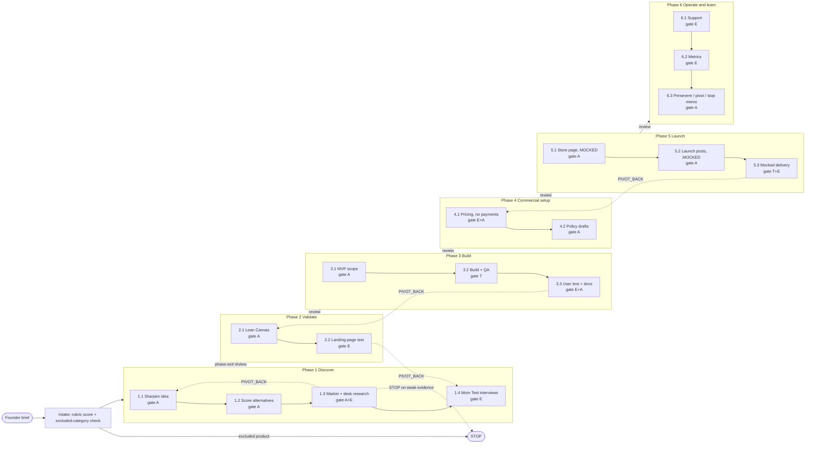
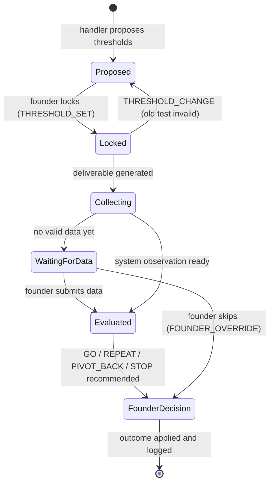
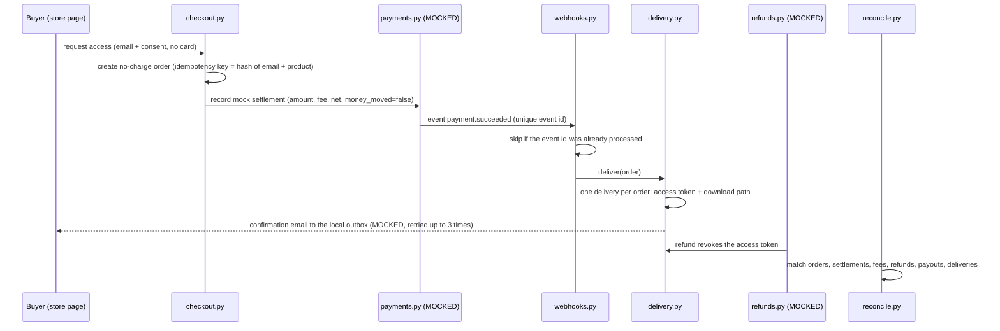
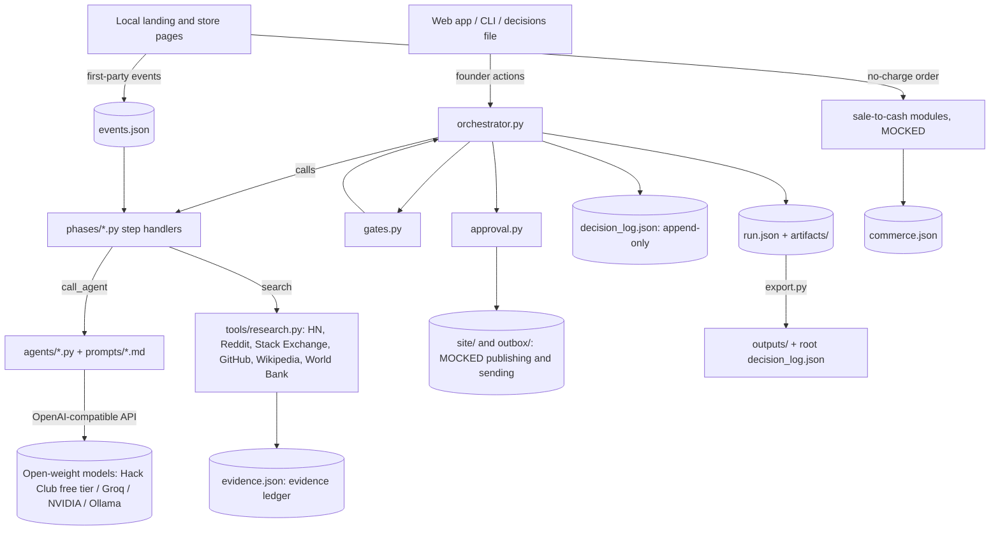

# Architecture

Venture Validator is an open-source team of AI agents that takes a founder's idea through six gated phases toward a validated, sellable **digital** product, and says "don't launch this" when the evidence is weak. The founder approves every deliverable and every outward action; gates are computed in code from thresholds locked before any data is collected; every agent action is appended to a decision log.

## Overview

Each of the 17 steps is run by a role agent (an open-weight model with its own prompt in `prompts/`) and ends with a gate. Gates are one or more of **A** (founder approval), **E** (evidence threshold, locked before the test) and **T** (passing tests). The orchestrator (`orchestrator.py`) is a state machine that pauses whenever it needs the founder: to lock thresholds, to submit data the system cannot observe itself, to approve or reject a deliverable, to accept or override a recommended outcome, and to answer the phase-exit review. The founder uses the web app (`app.py`) or the CLI (`cli.py`).

Code layout (named by role): `orchestrator.py` (state machine), `steps.py` (step registry), `phases/*.py` (one handler per step), `agents/<role>.py` + `prompts/<role>.md` (role agents), `gates.py` (gate engine), `approval.py` (founder approval enforcement), `guardrails.py` (hard limits), `evidence.py` (evidence ledger), `logbook.py` (decision log), `tools/research.py` (free public sources), `checkout.py`, `payments.py`, `webhooks.py`, `delivery.py`, `refunds.py`, `reconcile.py` (MOCKED sale to cash), `app.py` (web), `cli.py` (CLI and scripted founder), `export.py` (writes `outputs/`).

## Phases

Every step produces a markdown deliverable with a status line `[Phase X: Name | Step X.Y | Repeat n/2 | Last gate: ...]`, its claims (each `SOURCED` with evidence IDs, `FOUNDER_REPORTED`, `ESTIMATE` with a basis, or `ASSUMPTION`), the evidence it cites, at most three questions for the founder, and a gate report in the fixed format.

### Phase 1: Discover

| Step | Agent(s) | Tools and method | Output | Gate |
|---|---|---|---|---|
| 1.1 Sharpen the idea | `strategist` | Rewrites the idea as "[segment] struggles with [problem] when [situation]; today they [workaround], which costs them [cost]" (marked HYPOTHESIS); maps buying roles; generates 3-5 alternative concepts that each change one assumption (segment, problem, buyer, delivery, model) plus the status quo | Problem statement, role map, concept cards, sharp follow-up questions | A: founder approves the framing |
| 1.2 Score against alternatives | `strategist` | Model scores each concept 1-5 per factor with low/base/high and a basis; **code** computes weighted totals (severity x3, frequency x2, willingness to pay x3, reachability x2, founder fit x2, competition gap x1, speed to MVP x1), ranges, hard blockers and a rank-sensitivity check | Weighted scorecard, recommended concept (even if not the founder's original) | A: founder selects; picking a lower-ranked concept needs a logged reason |
| 1.3 Define the market | `researcher`, `market_analyst` | Thresholds are locked **before** research runs. `tools/research.py` queries free, keyless public sources (Hacker News Algolia, Reddit JSON, Stack Exchange, GitHub, Wikipedia pageviews, World Bank). Every hit becomes an evidence row with URL, date and independence group; a model only labels which rows describe the problem. Code counts independent discussions and verified community sizes; TAM/SAM/SOM are computed in code from labelled inputs | ICP, bottom-up market model with ranges, competitor and substitute matrix, channel list, coverage gaps | A + E: independent problem discussions (default >= 5; Hacker News and Stack Exchange searched over 24 months, Reddit over 12) and the largest verified community (default >= 1,000 members). If every discussion source fails, the count is "insufficient data", not 0 |
| 1.4 Customer interviews (Mom Test) | `interviewer` | Script that asks only about past behaviour (no pitching, no "would you"), screener, recruiting plan with two sources, note template; founder-submitted notes are coded deterministically, compliments and hypotheticals discounted | Interview kit; coded evidence table with Wilson intervals | E: >= 10 interviews, >= 60% describe the problem unprompted, >= 30% already spend time or money, >= 3 commitments |

### Phase 2: Validate

| Step | Agent(s) | Tools and method | Output | Gate |
|---|---|---|---|---|
| 2.1 Lean Canvas | `business_designer` | Nine boxes, each linked to Phase 1 evidence or labelled `ASSUMPTION`; three riskiest assumptions ranked by loss if wrong, each with a test | Evidence-linked canvas, assumption register, channel list | A |
| 2.2 Landing-page demand test | `growth_marketer` | Honest landing page (no fake proof or urgency; guardrails scan the copy) with a waitlist form and first-party page-view events, served by the app. Publishing it is a founder-approved, MOCKED action. Code counts unique non-internal visitors and hashed sign-ups after the locked 14-day window | Page, traffic plan, event dictionary, funnel table with Wilson interval | E: >= 300 eligible visitors (floor) and >= 10% sign-up rate |

### Phase 3: Build

| Step | Agent(s) | Tools and method | Output | Gate |
|---|---|---|---|---|
| 3.1 MVP scope | `product_manager` | Trigger -> input -> action -> output -> outcome map; at most five must-haves, each with machine-checkable acceptance criteria; explicit won't-build list | One-page MVP spec | A |
| 3.2 Build and test | `builder`, `qa` | Builds a small self-contained digital product (static web tool, data in the browser). QA runs deterministic checks: every acceptance criterion, HTML validity, no external requests, no card or password fields, no fake marketing claims, size limits | Product files and a test report | T: 100% critical checks pass, every acceptance criterion met, 0 open critical/high bugs (fixed by system policy) |
| 3.3 User test and docs | `doc_writer` | Docs written from the built files (quick start, FAQ, how-to, known limitations) and a moderated usability-test plan for >= 5 waitlist users | Docs and test plan; task-level results when submitted | E + A: >= 5 participants (floor), >= 80% complete the core task unassisted, 0 critical failures; founder approves the docs |

### Phase 4: Commercial setup (no payments of any kind)

| Step | Agent(s) | Tools and method | Output | Gate |
|---|---|---|---|---|
| 4.1 Pricing | `pricing_analyst` | Three anchors: economics floor computed in code (variable cost / (1 - target margin)), comparable prices only from evidence rows, value estimate; 2-3 packages; Van Westendorp survey and a no-charge "Choose plan -> Coming soon" click test. Van Westendorp intersections are computed in code | Price hypothesis, packages with sample bills, research design | E + A: >= 30 responses (floor), recommended price inside the acceptable range, >= 5% plan-click rate; founder approves |
| 4.2 Draft legal policies | `legal_drafter` | Terms, privacy and refund drafts based on the data the prototype actually handles; code forces the first line "DRAFT, not legal advice. Must be reviewed by a qualified lawyer before use." | Three drafts, counsel questions | A: approval requires an explicit, logged acknowledgment that a lawyer must review them |

### Phase 5: Launch

| Step | Agent(s) | Tools and method | Output | Gate |
|---|---|---|---|---|
| 5.1 Store page | `launch_marketer` | Store page with the proposed future price, FAQ and policy links, labelled "MOCKED store: no payment is taken"; its CTA creates a no-charge mock order | Store page (published to the local MOCKED site only after approval) | A |
| 5.2 Launch posts | `launch_marketer` | One draft per channel from the canvas, with schedule and attribution IDs; each post is its own approval item; "sending" writes to a local outbox (MOCKED); the founder posts manually from their own account | Post drafts and schedule | A: founder approves each post |
| 5.3 Automatic delivery (mocked) | `delivery` (code) | Runs the sale-to-cash test suite (below) and reads store-page events for demand | Delivery test log (`payment_test_log.md`), demand funnel | T + E: 100% delivery tests pass with >= 3 failure cases; >= 500 store visitors (floor) and >= 3% buy-intent rate |

### Phase 6: Operate and learn

| Step | Agent(s) | Tools and method | Output | Gate |
|---|---|---|---|---|
| 6.1 Support | `support_lead` | Knowledge base from the docs, ticket categories and severities, honest response templates, escalation rules; ticket metrics computed in code | Support workflow | E: >= 1 real ticket (floor), median first response <= 24 h, no critical issue open > 72 h |
| 6.2 Metrics | `metrics_analyst` | Metric definitions with numerator, denominator and window; code computes what the system observes itself (visitors, sign-ups, mock order requests) and marks the rest "not observable yet" | Decision dashboard spec and data-quality report | E: cohort floor, activation >= 40%, week-4 retention >= 20%, "very disappointed" >= 40% |
| 6.3 Persevere-or-pivot memo | `memo_writer` | Cross-phase gate table built in code; **PERSEVERE is allowed only if every E/T gate passed without override**; unit economics computed in code from labelled inputs; next three experiments | Decision memo | A: founder records PERSEVERE / PIVOT / STOP; a different choice is a logged override |

## Gates

Gate engine: `gates.py`. The decision rule is deterministic code. Two gate inputs come from a model and are labelled as such: the 1.3 relevance labels (which collected rows describe the problem) and optional `MODEL_REVIEW` bug reports in 3.2, which count only with a concrete reproduction.

1. **Lock before data.** E and T thresholds live in a versioned contract. The founder locks it (tuning targets is allowed only at lock time). Test-gate thresholds are fixed by system policy. Evaluating an unlocked contract raises an error.
2. **Measure.** Observations come from the system itself (research counts, page events, test runs) or from the founder (`submit_data`, logged as founder data and scored with the Founder Answer Rubric). Missing values never pass: the measurement state is `WAITING_FOR_DATA` or `INSUFFICIENT_DATA` and the gate has **no outcome** until valid data arrives.
3. **Decide (exactly one outcome).**

| Result | Outcome |
|---|---|
| Every locked criterion met | `GO` |
| Weakest criterion >= 70% of target (near miss) and fewer than 2 repeats used | `REPEAT` with one named change |
| Failing test (T gate) and fewer than 2 repeats used | `REPEAT` (fix and re-run; tests are never skipped) |
| Weakest criterion < 70% | `PIVOT_BACK` to the step whose assumption the evidence contradicts (alternative: `STOP`) |
| Weakest criterion < 25% of target, or the step already failed and caused a pivot | `STOP` (alternative: `PIVOT_BACK`) |
| Sample or traffic floor missed | Gate fails on the floor; demand criteria are reported as "not adjudicated" (test criteria stay adjudicated). A small sample is not evidence against demand, so the recommendation is `REPEAT` (fix recruitment or traffic), then `PIVOT_BACK` to the channel step after the repeat limit, never `STOP` |
| A binary or hard criterion missed (e.g. a blocker, a 0/1 check) | `PIVOT_BACK` to the step's pivot target rather than STOP; failing tests are `REPEAT` |
| Third failure (repeat limit reached) | `PIVOT_BACK` or `STOP` only |

**Decision-quality evals.** `evals/gate_cases.yaml` encodes the playbook's review set (12/100 sign-ups, the 30/300 boundary, a near miss after two repeats, a tracking outage, an immature window, a missing value, ten interviews from two organizations, a traffic floor missed after repeats, failing tests hidden by low traffic, a binary price-range miss, repeated failure after a pivot, a smaller-is-better near miss, all criteria met, and an unlocked contract). `python evals/run_gate_evals.py` and `tests/test_gate_evals.py` check the engine against every case.

4. **Founder decides.** The founder accepts the recommendation (`FOUNDER_APPROVAL`) or chooses another outcome with a reason (`FOUNDER_OVERRIDE`, logged next to the original recommendation). An override never counts as a passed evidence gate, and the final memo treats overridden gates as untested. Changing a locked threshold after data arrives is a `THRESHOLD_CHANGE`: the old test is marked invalid and must re-run under the new version.

**When the system recommends STOP on weak evidence.** Example from the spec: a locked target of 100 waitlist sign-ups in 14 days and an actual result of 12. The report's first line reads `GATE FAILED: signups 12/100 (12%). Recommendation: STOP or PIVOT_BACK.`, because 12% is below the 25% stop band. A brand-new idea with almost no independent public discussion of its problem fails the 1.3 gate the same way: in the committed weak-idea demo, desk research found 0 of the 5 locked independent discussions (0%), so the gate recommended STOP and the founder accepted it (`outputs/phase1_gate_weak-idea-market.md`). The main demo's 1.3 gate also recommended STOP (0/5 relevant discussions; Reddit was unreachable, which the report lists as a coverage gap); there the founder overrode it with a logged reason to continue the demo, and the final memo counts that gate as not passed. "No public data found" is reported as a coverage gap, and the report names the evidence that would reverse the recommendation.

**Phase-exit review.** After the last step of each phase the founder answers: deliverables match (Yes / Partly / No), what is missing, confidence 1-5. "Partly", "No" or confidence <= 2 reopens a step of that phase as a `REPEAT`.

## Sale to cash

Everything in this flow is **MOCKED**: there is no payment provider, no card or bank data, and no money moves. It exists to prove the mechanics a real store needs. Code: `checkout.py`, `payments.py`, `webhooks.py`, `delivery.py`, `refunds.py`, `reconcile.py`, with records in `commerce.py`.

- **Payment triggers delivery:** only a `payment.succeeded` event (mock settlement) leads to delivery.
- **A refund revokes access:** `refunds.refund` records a mock refund and the access token stops working (the access page returns 403).
- **Idempotency prevents double delivery:** a repeated order submit returns the same order; a repeated webhook event is ignored; `deliver` returns the existing delivery for the same order.
- **Reconciliation** matches orders, settlements, fees, refunds, payouts and deliveries, and reports mismatches such as a paid order without delivery, a delivery without settlement, duplicate deliveries, refunded orders with active access, or a payout that does not equal the sum of nets.

The suite `reconcile.run_delivery_test_suite` is the T part of gate 5.3. It runs ten scenarios on fixture data: happy path, duplicate submit, repeated delivery event, invalid product, delivery requires payment, email failure with retry, missing or expired access, refund revokes access, clean reconciliation, and reconciliation detecting five injected mismatches. Its log is `outputs/payment_test_log.md`.

## Data flow

- Every run lives in `data/runs/<run_id>/`: `run.json` (state), `decision_log.json`, `evidence.json`, `approvals.json`, `artifacts/step<id>/attempt<n>/`, `events.json`, `commerce.json`, `site/` and `outbox/`.
- The decision log has one entry per agent action with `timestamp`, `agent`, `action`, `sources` (URLs), `model`, `cost`, `approved_by`, plus `log_id`, `action_type`, `phase`, `step`, thresholds, result, gate outcome, approval status and override details. Model, token counts and cost come from the provider's response, never from a guess.
- Founder data, observations, source facts, estimates, hypotheses and test fixtures are kept apart by provenance type in the evidence ledger. Fixtures never count toward a gate.
- `export.py` writes a run's deliverables, gate reports and phase reviews to `outputs/` using the `phase<N>_step<M>_<name>` and `phase<N>_gate_<name>` names, and copies the log to the root `decision_log.json`.

## Built vs. stubbed

| Part | Status |
|---|---|
| Orchestrator, gate engine, approval enforcement, decision log, evidence ledger, guardrails | Built |
| All 17 step handlers and their role agents and prompts | Built |
| Desk research on free public sources | Built (Reddit often blocks anonymous requests; this is reported as a coverage gap) |
| Landing page, waitlist, store page and first-party events | Built, served locally; public publishing is **MOCKED** |
| Launch posts | Drafts only; sending writes to a local outbox (**MOCKED**) |
| Checkout, settlement, webhooks, delivery, refunds, payouts, reconciliation | **MOCKED** (no provider, no money, no card data) |
| Confirmation emails | **MOCKED** (written to a local outbox) |
| Interviews, usability sessions, pricing surveys, support tickets, retention cohorts | Collected by the founder in the real world; the system designs them, locks thresholds and analyses submitted data |
| Model in the automated test suite | **STUBBED** (`FakeLLM` with fixture replies) |

## Roadmap

1. **Evidence quality:** fetch and quote the underlying page for each high-impact claim, add a verifier pass that rejects claims a source does not support, and add more free sources (Google Trends via an export, official statistics portals).
2. **Real-world loops:** import interview notes, survey exports and analytics CSVs directly; schedule re-evaluation when a locked window closes.
3. **Randomised tests:** two-arm message and price tests with sample-ratio checks, as described in the playbook.
4. **Multi-founder workspaces:** authentication, roles and an audit view of approvals.
5. **Optional real integrations behind explicit founder setup:** email sending and a payment provider in test mode, each gated by the same approval code; never enabled by default.
