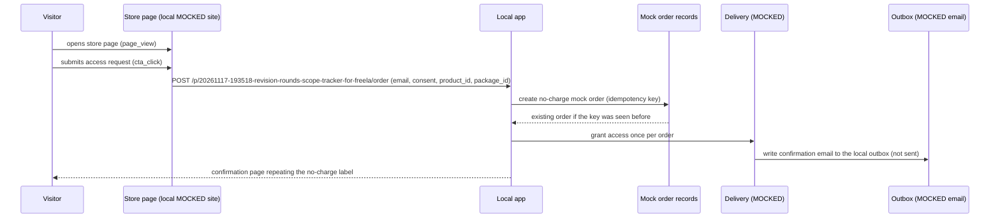

# 5.3 Automatic delivery (mocked): Revision Rounds - scope tracker for freelance web designers

`[Phase 5: Launch | Step 5.3 | Repeat 0/2 | Last gate: GO]`

Venture: **Revision Rounds - scope tracker for freelance web designers** | Run `20261117-193518-revision-rounds-scope-tracker-for-freela` | Attempt 0 | Generated 2026-11-17T19:50:48Z

**What I'm doing now:** Explained the mocked purchase-to-delivery flow; the delivery tests run when you lock the thresholds, and demand is read from the store page's own events.

## Purchase-to-delivery flow (MOCKED)

No real money changes hands and no payment provider is involved. The flow below is what the local app does when someone requests access on the store page.

## Event definitions

| Event | Recorded when | Dedupe key | Counts as |
|---|---|---|---|
| `page_view` | store page loads | `visitor_id` | eligible store visitor |
| `cta_click` | the access-request form is submitted (browser) | `visitor_id` | buy intent |
| `order_request` | the server records the no-charge request | `email_hash` | buy intent (same person as the click, not added twice) |

Events flagged `internal` (founder, team, tests), fixture and bot-flagged events, and events outside the locked window are excluded. Buy-intent rate = buy intents / eligible store visitors, with a 95% Wilson interval.

## What is MOCKED

- Payment: none. There is no payment provider, no card or bank field and no charge; the CTA creates a no-charge mock order record.
- Order: a local mock order record with an idempotency key, stored in the run folder.
- Delivery: an access link or download grant written locally (MOCKED); no external system is called.
- Confirmation email: written to the local outbox (MOCKED); nothing is sent.
- Refunds: there is nothing to refund; the test only checks that revoking a mock order removes access.
- Test data: the delivery test suite runs on FIXTURE orders in a separate folder that analytics never reads.

## Gate T + E (thresholds locked before the launch window)

- T: 100% of end-to-end delivery tests pass, covering the happy path and at least 3 failure cases (duplicate order, failed email, invalid product). The suite runs automatically once the thresholds are locked; its log is saved as `payment_test_log.md`.
- E: over the 14-day launch window, at least 500 eligible store visitors and a buy-intent rate of at least 3%.
- Routing: failing tests -> REPEAT (fix and re-run); too few visitors -> 2.1 (channels); visitors but low intent -> 4.1 (price) or 2.2 (positioning).
